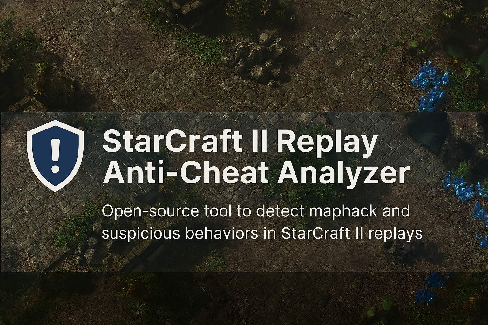

# 🎮 StarCraft II Replay Anti-Cheat Analyzer

Narzędzie open-source do wykrywania maphacka i podejrzanych zachowań w powtórkach StarCraft II. Analizuje ruchy kamery, pozycje jednostek i struktur, generuje alerty i wizualizacje. Stworzone z myślą o uczciwej rywalizacji, trenerach, casterach i fanach e-sportu.

## 🎯 Cel projektu

To narzędzie służy do analizy plików .SC2Replay w celu wykrywania oznak użycia maphacka i innych nieuczciwych zachowań. System działa w dwóch etapach:

1. Eksport danych z powtórki do bazy SQLite  
2. Analiza danych i generowanie alertów anty-cheat

## 🧱 Struktura projektu

starcraft-ii-replay-anti-cheat-analyzer/  
├── parser/              - Eksport danych z replaya do SQLite  
├── analyzer/            - Moduły analizy anty-cheat  
├── visualizer/          - Wizualizacje XY, heatmapy, timeline  
├── schema.sql           - Schemat bazy danych SQLite  
├── example_replays/     - Przykładowe pliki .SC2Replay  
├── README.md            - Ten plik  
└── requirements.txt     - Zależności Pythona

## ⚙️ Jak to działa?

1. Wczytaj powtórkę za pomocą sc2reader  
2. Zapisz dane o graczach, jednostkach, budynkach i kamerze do SQLite  
3. Uruchom analizę, która:  
   - Oblicza odległość kamery od baz przeciwników  
   - Wykrywa podejrzane ruchy kamery (np. przed scoutem)  
   - Generuje alerty i raporty

## 🧪 Przykładowe zastosowania

- Wykrywanie maphacka  
- Analiza świadomości mapy (map awareness)  
- Trening AI do przewidywania stylu gry  
- Narzędzie dla casterów i trenerów

## 📦 Wymagania

- Python 3.10+  
- sc2reader  
- sqlite3  
- matplotlib (dla wizualizacji)

Zainstaluj zależności:  
```bash
  pip install -r requirements.txt
```

## 🧪 Przykład użycia

### Parsuj replay i uruchom analizę
`python cli.py example_replays/game.SC2Replay --analyze`

### Parsuj replay i pokaż wizualizację kamery gracza #1
`python cli.py example_replays/game.SC2Replay --visualize 1`

### Tylko parsuj replay
`python cli.py example_replays/game.SC2Replay`

## 📜 Licencja

Projekt open-source, dostępny za darmo dla społeczności SC2. Licencja: GNU GPL 3.0.

## ✨ Autor

Projekt stworzony przez Dawid Bielecki `dawciobiel` — dla uczciwych graczy, przeciwko oszustom.
